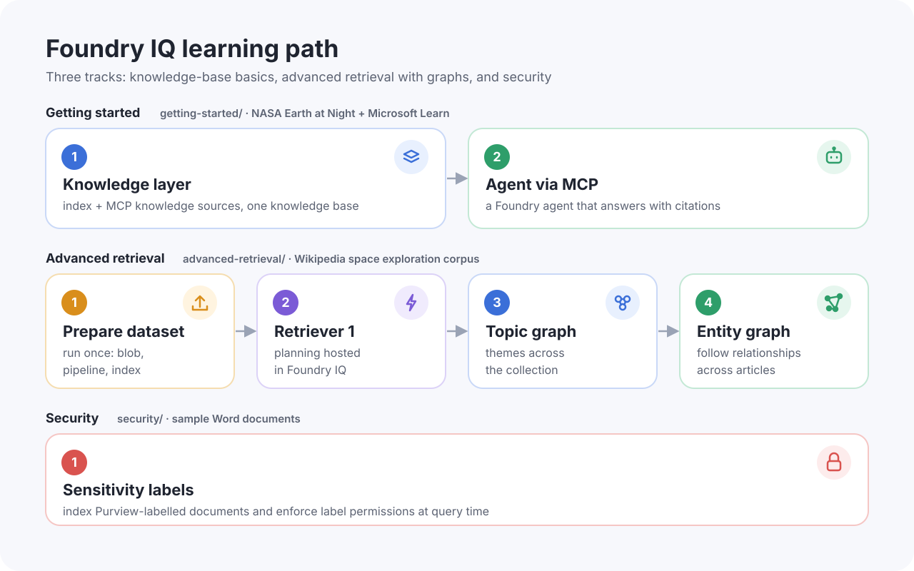

# Foundry IQ: End-to-End Agentic Retrieval with Azure AI Search

A demo repo showcasing **Foundry IQ**, the managed knowledge layer in Azure AI Search that turns enterprise content into reusable, permission-aware knowledge bases for agents. It goes from the basics of knowledge bases and agents through **Microsoft Retriever 1**, **topic graphs** and **entity graphs**.

## Learning path

| # | Notebook | What it covers | Dataset |
|---|----------|----------------|---------|
| 1 | [01-basics/01-foundry-iq-knowledge-layer.ipynb](01-basics/01-foundry-iq-knowledge-layer.ipynb) | Search index, two knowledge sources (SearchIndex + Microsoft Learn MCP server), knowledge base, agentic retrieval | NASA Earth at Night + Microsoft Learn |
| 2 | [01-basics/02-foundry-agent-mcp-integration.ipynb](01-basics/02-foundry-agent-mcp-integration.ipynb) | Connect the knowledge base to a Foundry Agent via MCP; multi-turn conversations with citations | Same as 1 |
| 0 | [00-setup/prepare-space-dataset.ipynb](00-setup/prepare-space-dataset.ipynb) | **Run once before 3–5.** Fetch ~230 Wikipedia articles, upload to Blob Storage, build an indexer + skillset pipeline that chunks and embeds server-side | Space exploration (Wikipedia) |
| 3 | [02-knowledge-retrieval/01-microsoft-retriever-1.ipynb](02-knowledge-retrieval/01-microsoft-retriever-1.ipynb) | Microsoft Retriever 1: direct agentic search, a Retriever 1-only knowledge base, `auto` reasoning effort, side-by-side comparison | Space exploration |
| 4 | [03-graph/01-topic-graph.ipynb](03-graph/01-topic-graph.ipynb) | Why and how topic graphs work; build with the Foundry IQ skills plugin; `none` vs `balanced` vs `diverse` | Space exploration |
| 5 | [03-graph/02-entity-graph.ipynb](03-graph/02-entity-graph.ipynb) | Why and how entity graphs work; ontology design, graph-enabled Blob knowledge source with ingestion cache, ontology v1 → v2, GQL and knowledge base queries | Space exploration (subset) |

Plus [docs/foundry-iq-skills-guide.md](docs/foundry-iq-skills-guide.md): how to use the Foundry IQ skills plugin, and what you can and can't do without it.

### Why two datasets?

- **Basics (1–2)** deliberately combine two *unrelated* sources, NASA Earth at Night (indexed) and Microsoft Learn (remote MCP), so the activity log clearly shows query planning **routing** subqueries to the right source.
- **Retriever 1 and graphs (3–5)** share one relationship-rich Wikipedia corpus on **space exploration**, so you can ask the *same* questions with plain search, Retriever 1, a topic graph and an entity graph and compare. It has many **themes** (Space Race, Apollo, space stations, Mars, telescopes, commercial spaceflight) for topic graphs, and many **relationships** (astronaut → mission → launch site → country) for entity graphs.

## Architecture



## Prerequisites

### Azure resources

| Resource | Needed by | Notes |
|---|---|---|
| **Azure AI Search**, Basic tier or higher | All | Region must support [agentic retrieval](https://learn.microsoft.com/azure/search/search-region-support); notebook 3 (Microsoft Retriever 1) needs **Japan East, North Europe, West Central US or West US 3** |
| Search **Standard Knowledge Retrieval** plan | 3 | Required for Microsoft Retriever 1 |
| **Microsoft Foundry resource** (`services.ai.azure.com`) | All | LLM deployment (e.g. `gpt-5.4-mini`) and `text-embedding-3-large` |
| Chat deployment for graphs (`gpt-5.6-luna` recommended) | 4, 5 | Entity extraction, graph query planning, topic naming. Falls back to `LLM_DEPLOYMENT` |
| **Microsoft Foundry project** | 2 | Agent integration |
| **Storage account**: general-purpose v2, **not** ADLS Gen2, with Blob and Table storage | 0, 5 | Keyless (shared-key access can stay disabled). Blob **soft delete on** and **versioning off**: set once with `az storage account blob-service-properties update` (see notebook 0, Step 3) |
| **GitHub Copilot CLI**, Git, Node.js, Python 3.12+, Azure CLI, Windows x64 or Linux | 4 | Foundry IQ skills plugin; see the [guide](docs/foundry-iq-skills-guide.md) |

### Permissions and identity

| Scope | Role | Assign to | Purpose |
|-------|------|-----------|---------|
| Azure AI Search | Search Service Contributor | You | Create indexes, indexers, knowledge sources, knowledge bases |
| Azure AI Search | Search Index Data Contributor | You | Upload documents |
| Azure AI Search | Search Index Data Reader | You **and** the Foundry project managed identity | Query indexes and knowledge bases |
| Foundry resource | Cognitive Services User | Azure AI Search managed identity | Embedding skill, vectorizers, knowledge base models, graph extraction |
| Foundry resource | Cognitive Services OpenAI User | You | Local LLM calls in notebook 5 (extraction demo) |
| Foundry project | Foundry User, Foundry Project Manager | You | Agents and project connections (notebook 2) |
| Storage account | Storage Blob Data Contributor | You | Create containers and upload articles (notebook 0) |
| Storage account | Storage Account Contributor | You | One-time soft delete / versioning settings (notebook 0, Step 3) |
| Storage account | Storage Blob Data Contributor, Storage Table Data Contributor | Azure AI Search managed identity | Indexer reads blobs; entity graph reads blobs and writes its ingestion cache |

> **Identity setup:** enable a **system-assigned managed identity** on the search service and give it **Cognitive Services User** on the Foundry resource and the storage roles above. Storage is accessed **without keys**: the notebooks use your Entra identity (`DefaultAzureCredential`), and the search service uses `ResourceId=…` connections with its managed identity. Only `AZURE_STORAGE_RESOURCE_ID` is needed in `.env`.

## Getting started

1. **Clone** this repo
2. **Create `.env`** from the template and fill in your values:
   ```bash
   cp .env.sample .env
   ```
3. **Install dependencies:**
   ```bash
   pip install -r requirements.txt
   ```
4. **Sign in** (for `DefaultAzureCredential`):
   ```bash
   az login
   ```
5. **Run the notebooks** in the order of the learning path. Run `00-setup` once before notebooks 3–5.

## API versions

Every notebook uses the same SDK: **`azure-search-documents==12.2.0b1`**, which targets the **`2026-11-01-preview`** REST API. That version is required for Microsoft Retriever 1, topic graphs, entity graphs, the ingestion cache and MCP server knowledge sources. The knowledge base MCP endpoint in `01-basics/02` uses the same API version (`SEARCH_API_VERSION`).

## Data and licensing

The space exploration corpus is fetched from English Wikipedia at run time and cached in `data/space-exploration/cache/` (git-ignored). Wikipedia text is licensed under [CC BY-SA 4.0](https://creativecommons.org/licenses/by-sa/4.0/); every indexed chunk keeps its `source_url` for attribution. The committed files are only the title lists and ontologies.

## Key references

- [Agentic retrieval overview](https://learn.microsoft.com/azure/search/agentic-retrieval-overview)
- [What is Foundry IQ?](https://learn.microsoft.com/azure/ai-foundry/agents/concepts/what-is-foundry-iq)
- [Use Microsoft Retriever 1](https://learn.microsoft.com/azure/search/agentic-retrieval-how-to-use-microsoft-retriever)
- [Knowledge graph features overview](https://learn.microsoft.com/azure/search/knowledge-graph-features-overview)
- [Configure topic graph retrieval](https://learn.microsoft.com/azure/search/agentic-knowledge-source-how-to-topic-graph)
- [Create and query an entity graph](https://learn.microsoft.com/azure/search/agentic-knowledge-source-how-to-entity-graph)
- [Install Foundry IQ skills](https://learn.microsoft.com/azure/search/agentic-retrieval-how-to-install-foundry-iq-skills)
- [MCP server knowledge source](https://learn.microsoft.com/azure/search/agentic-knowledge-source-how-to-mcp-server)
- [Connect Foundry IQ to Foundry Agent Service](https://learn.microsoft.com/azure/ai-foundry/agents/how-to/foundry-iq-connect)
