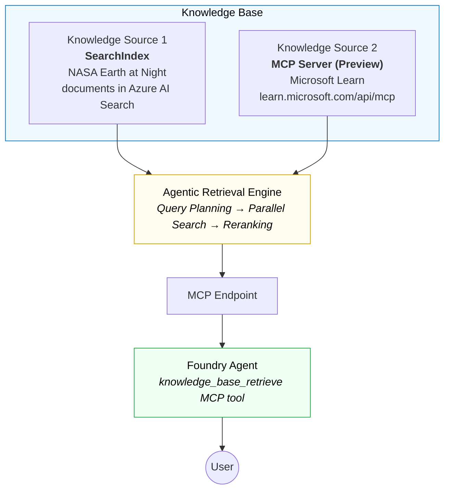

# Foundry IQ: End-to-End Agentic Retrieval with Azure AI Search

A demo repo showcasing upcoming **Foundry IQ** features — the managed knowledge layer in Azure AI Search that transforms enterprise content into reusable, permission-aware knowledge bases for agents.

## What You'll Build

| Notebook | What It Covers |
|----------|----------------|
| [foundry-iq-knowledge-layer.ipynb](foundry-iq-knowledge-layer.ipynb) | Create a search index, ingest data, configure two knowledge sources (SearchIndex + Microsoft Learn MCP server), build a knowledge base, and run agentic retrieval queries |
| [foundry-agent-mcp-integration.ipynb](foundry-agent-mcp-integration.ipynb) | Connect the knowledge base to a Foundry Agent via MCP, create an agent with knowledge retrieval tools, and run multi-turn conversations with citations |

## Architecture



## Prerequisites

### Azure Resources

1. **Azure AI Search** — Basic tier or higher, in an [agentic-retrieval-supported region](https://learn.microsoft.com/en-us/azure/search/search-region-support)
2. **Microsoft Foundry resource** (AI Services endpoint: `services.ai.azure.com`) with:
   - An LLM deployment (e.g., `gpt-5.4-mini`)
   - An embedding model deployment (`text-embedding-3-large`)
3. **Microsoft Foundry project** (required for the agent integration notebook)

### Permissions & Identity

| Scope | Role | Assign To | Purpose |
|-------|------|-----------|---------|
| Azure AI Search | Search Service Contributor | Your user / service principal | Create indexes, knowledge sources, knowledge bases |
| Azure AI Search | Search Index Data Contributor | Your user / service principal | Upload documents |
| Azure AI Search | Search Index Data Reader | Your user / service principal **and** Foundry project managed identity | Query indexes and knowledge bases |
| Foundry resource | Cognitive Services User | Azure AI Search managed identity | Allow search service to access LLM and embedding models via AI Services endpoint |
| Foundry project | Foundry User | Your user / service principal | Create agents and model deployments |
| Foundry project | Foundry Project Manager | Your user / service principal | Create project connections |

> **Identity setup**: Enable a **system-assigned managed identity** on your Azure AI Search service, then assign it the **Cognitive Services User** role on your Microsoft Foundry resource. For the agent integration notebook, also assign the **Foundry project's managed identity** the **Search Index Data Reader** role on the Azure AI Search service.

## Getting Started

1. **Clone or download** this folder

2. **Create a `.env` file** from the template:
   ```bash
   cp .env.sample .env
   ```
   Fill in your Azure resource endpoints and deployment names.

3. **Install dependencies**:
   ```bash
   pip install -r requirements.txt
   ```

4. **Authenticate** (if using `DefaultAzureCredential`):
   ```bash
   az login
   ```

5. **Open and run** the notebooks in order, starting with `foundry-iq-knowledge-layer.ipynb`.

## API Version

These notebooks use the **`2026-05-01-preview`** REST API (via the preview `azure-search-documents` Python SDK). This version is required for:

- MCP server knowledge sources
- Answer synthesis output mode
- Configurable retrieval reasoning effort

## Key References

- [Agentic retrieval overview](https://learn.microsoft.com/en-us/azure/search/agentic-retrieval-overview)
- [What is Foundry IQ?](https://learn.microsoft.com/en-us/azure/ai-foundry/agents/concepts/what-is-foundry-iq)
- [Create a knowledge base](https://learn.microsoft.com/en-us/azure/search/agentic-retrieval-how-to-create-knowledge-base)
- [MCP server knowledge source](https://learn.microsoft.com/en-us/azure/search/agentic-knowledge-source-how-to-mcp-server)
- [Connect Foundry IQ to Foundry Agent Service](https://learn.microsoft.com/en-us/azure/ai-foundry/agents/how-to/foundry-iq-connect)
